

<table>
<tr>
<td align="center" width="140"><picture>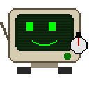</picture></td>
<td><b>A note from the webmaster</b> The code, the docs and all the art on this page were made by <b>Claude</b>, an AI by <a href="https://www.anthropic.com/">Anthropic</a>, working with me: I pick what to build and test every build on my real PCs, Claude writes it and checks it in emulators first. Sister site: <a href="https://github.com/deon81997/NUKED-SBEMU">NUKED SB-EMU</a> (a Roland SC-55 for your DOS games) - FRAMELOG runs right next to it</td>
</tr>
</table>

<table>
<tr>
<td align="center" valign="top"><picture>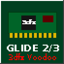</picture>  <picture>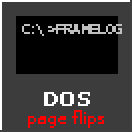</picture>  <picture>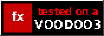</picture>  <picture>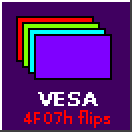</picture></td>
<td align="center" valign="top">

<picture>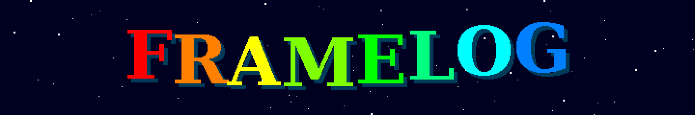</picture>

<h2>~*~ Welcome to my Retro GPU Benchmark Page ~*~</h2>

<i>Times every frame your DOS and Windows 98 games draw. No overlay, no FRAPS, no patched files</i>

  

<picture>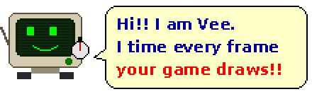</picture>

<h3>~ What can it time? ~</h3>(click a card) 

 
<a href="#-cool-features-">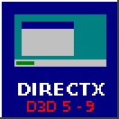</a>
<a href="#-cool-features-">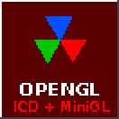</a>
<a href="#-coming-soon-">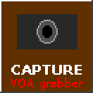</a>

  

<picture></picture> 
this page is ALWAYS under construction... please come back soon :-)

  

<a href="https://github.com/deon81997/framelog/releases/tag/v0.1-test10">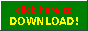</a>
<picture>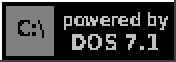</picture>
<picture>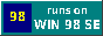</picture>
<picture>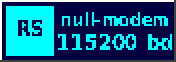</picture>

  

</td>
<td align="center" valign="top"><picture></picture>  <picture>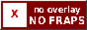</picture>  <picture></picture>  <picture></picture></td>
</tr>
</table>

<table>
<tr>
<td align="center"><b>Test build counter:</b> <picture>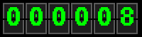</picture> test builds and counting!</td>
<td align="center"><picture>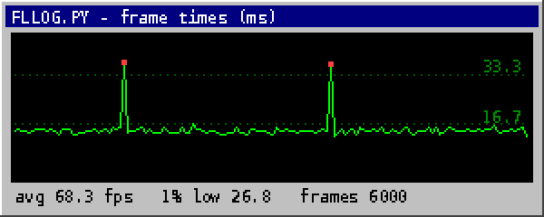</picture> (what your host PC sees: every frame, live)</td>
<td align="center"><picture></picture></td>
</tr>
</table>

 

<a href="#-whats-new-">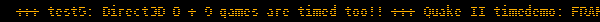</a>

  

<picture></picture>

 

<b>~ SITE MAP ~</b> (click a button)

<table>
<tr><td><a href="#-whats-new-">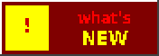</a></td><td><a href="#-what-is-this-">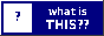</a></td><td></td><td><a href="#-my-game-scores-">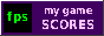</a></td></tr>
<tr><td><a href="#-my-test-lab-">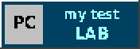</a></td><td><a href="#-getting-started-">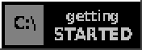</a></td><td><a href="#-the-cable-">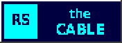</a></td><td></td></tr>
<tr><td></td><td></td><td><a href="#-for-the-nerds-source-code-">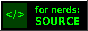</a></td><td><a href="#-thanks-to-my-friends-">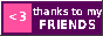</a></td></tr>
</table>

<picture></picture>

## <picture></picture> What's New <picture></picture>
<picture></picture> **11/18/2026: test10.** **Carmageddon and other games with Glide built in.** Some DOS Glide games have no GLIDE2X.OVL: Glide is inside the game's own files (Carmageddon: CARM3DFX.EXE + 3DFX_DOS.BDD). FRAMELOG now scans .EXE and .BDD files once while the game loads, finds grBufferSwap and times every swap there too. Tested on a Voodoo Graphics in 86Box: Carmageddon 6887 swaps = 6887 frames, 0 lost; Extreme Assault and Archimedean Dynasty still exact. Cost: within noise while playing, 0.2-0.3 s once at load. `FRAMELOG /STATUS` has a new "Static Glide" line (error codes 20-24 in FRAMELOG.TXT). Windows 98 and host files are test9's, unchanged.

<picture></picture> **11/18/2026: test9.** **Live stats while you log!!** The host logger (`LOG COM3 run.csv NAME` or `fllog.py`) now redraws one status line every second: frames so far, fps over the last second and since the start, the last and the slowest frame time, and lost frames - so you can see it working before you press Ctrl+C. The numbers are the game PC's own timing, the same as in the CSV. `--no-live` turns it off; test rigs that pipe the output get no status line. Game PC files are test8's, unchanged. Tested against a fake game PC on a socket (single run and suite: 60 fps, a loading pause, a dropped-frames record).

<picture></picture> **11/18/2026: test8.** **DOS Glide games on a 3dfx Voodoo.** FRAMELOG now times DOS games that use 3dfx's GLIDE2X.OVL: every buffer swap is a frame. It also fixes the OVL's start code, which stops with "DLL load aborted" under HDPMI32i even without FRAMELOG. Tested on a Voodoo Graphics in 86Box: Extreme Assault and Archimedean Dynasty log every frame with 0 lost, Redguard logs; games with Glide built into the EXE (Carmageddon) are not covered yet. Cost: under 0.1%. Start order and a Voodoo PC checklist are in FRAMELOG.TXT.

<picture></picture> **11/18/2026: test7.** **Tested on three 3dfx cards.** Quake II (3dfx MiniGL, OpenGL ICD, software), Unreal Tournament (Glide), Expendable, Incoming and 3DMark99 on a Voodoo Graphics, a Voodoo2 and a Voodoo3: FRAMELOG matches the games' own numbers to within 0.1% (about 1% for Expendable, which times in whole seconds). Fixes: Voodoo2 and Voodoo3 get their real names in Glide games, the first DirectDraw game no longer loses its card name, and 3DMark99 on a Voodoo2 add-on card is logged as the Voodoo2. Details on the [Game Coverage](https://github.com/deon81997/framelog/wiki/Game-Coverage) page.

<picture></picture> **11/17/2026: test6.** **Quake II's software renderer is timed too.** It never flips: it copies each frame to the screen with DirectDraw's BltFast, and FRAMELOG now catches that. Quake II scores the same 39.9 fps with and without FRAMELOG. Plus a brand-new **[wiki](https://github.com/deon81997/framelog/wiki)** that explains every switch.

## <picture></picture> What is this? <picture></picture>

<picture>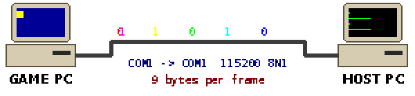</picture>

FRAMELOG is a **frame-time logger** for old PCs. The **game PC** (DOS or Windows 98) notes the exact moment each frame is shown and sends it down a **serial cable**. A **second PC** (the host, any OS with Python) does all the rest: CSV logs, average fps, 1% / 0.1% lows, frame-time graphs and side-by-side HTML reports for every graphics card you own.

Why not FRAPS? No overlay on your picture, no file writes during the game, and it works in **plain DOS** too. Load it once and every game is logged: no per-game patches, no replaced DLLs.

Measured cost on a Pentium II 450: within run-to-run noise (about 0.5%) for every API.

## <picture></picture> Cool Features <picture></picture>

- <picture></picture> **DOS page flips** - traps the VGA start-address writes (CRTC 0Ch/0Dh), 8- and 16-bit; resident under HDPMI32i, runs **next to NUKED SB-EMU + SC-55** without touching their ports or timers.
- <picture></picture> **VESA flips** - INT 10h 4F07h and the VBE 2.0 protected-mode interface (Duke 3D 640x480).
- **Mode 13h games that never flip** - optional vsync-poll mode (`/3DA`): one frame per wait for retrace.
- <picture></picture> **Glide 2 / Glide 3** - `grBufferSwap` on real 3dfx drivers.
- <picture></picture> **DirectDraw, Direct3D 5-7, Direct3D 8 and 9** - Flip / Blt / BltFast to the screen / Present.
- <picture></picture> **OpenGL** - the card's ICD, 3dfx MiniGL, any `wglSwapBuffers`.
- **Run info** - card, driver, resolution, colour depth, CPU, game and API go into every CSV by themselves.
- **Benchmark suites** - one batch of timedemos, one CSV per run, an HTML page per GPU and a side-by-side page.
- **Launch mode** - `FRAMELOG game.exe` catches even games that never open a normal window.

## <picture></picture> My Game Scores <picture></picture>
<picture></picture>

Emulated Pentium II 450 + Voodoo3 3000 AGP (3dfx 1.02.18 drivers, DirectX 9.0c) in 86Box. FRAMELOG's fps vs what the game itself says:

| Game | Test | The game says | FRAMELOG says | Diff |
| --- | --- | --- | --- | --- |
| Quake II 3.14 demo | `timedemo 1`, OpenGL (3dfx ICD) | 58.3 fps | 56.7 fps (whole run) | ~1% |
| Forsaken demo | Play Demo, biodome.dmo | 85.19 fps (19162 frames) | 84.80 fps (same 19162 frames) | 0.5% |
| Quake II 3.14 demo | `timedemo 1`, software renderer 640x480 | 39.9 fps | 39.9 fps (the 632 demo frames) | 0 |
| D3D8TEST / D3D9TEST | 40 fps, 200 frames | 25.00 ms | 199 frames at 25.00 ms | 0 |

Not yet: 3DMark99 (it crashes in the emulator even without FRAMELOG, so it waits for real hardware). **Real hardware results coming soon.**

## <picture></picture> My Test Lab <picture></picture>
- **Dell Latitude D810** - Pentium M 2 GHz, ATI Mobility Radeon X300, Windows 98 SE + MS-DOS 7.1 (the main target)
- **ASUS P5PE-VM** - Intel 865G, Leadtek GeForce 6800, Sound Blaster Audigy, Win98 / DOS
- **The host** - a modern PC running `fllog.py` at the other end of the cable
- **Emulators** - 86Box (Pentium II 450, Cirrus or Voodoo3) and QEMU, where every build is tested first

## <picture></picture> Getting Started <picture></picture>

1. **Download** the zip (below) and copy `FRAMELOG\` (DOS) or `WIN98\` (Windows 98) to the game PC, `HOST\` to the host PC. The host part is also its own small download, `FRAMELOG-HOST-<version>.zip` on the same release page: unzip it, double-click `FLLOG.BAT` to log a run and `REPORT.BAT` for the web pages.
2. Plug a **null-modem cable** between COM1 of the game PC and the host (a USB-serial adapter is fine on the host).
3. **DOS:** `FRAMELOG /COM:1` after HDPMI32I (or after SC55), then start your game.
   **Windows 98:** run `FRAMELOG`, then start the game - or `FRAMELOG C:\GAMES\QUAKE2\QUAKE2.EXE +timedemo 1 ...`.
4. **Host:** `python3 fllog.py COM3 -o run.csv`, play, Ctrl+C, then `python3 flstats.py run.csv --png run.png`.
5. Many games in a row: `python3 fllog.py COM3 --suite suite.ini --report report/` = one CSV per run + HTML pages.

Every switch, explained: the **[wiki](https://github.com/deon81997/framelog/wiki)**. The same in the zip: `FRAMELOG\FRAMELOG.TXT` (DOS) and `WIN98\FRAMEL98.TXT` (Windows 98), each with a hardware test checklist.

## <picture></picture> The Cable <picture></picture>

<picture></picture>

Any **null-modem** cable (RX/TX crossed), 115200 baud 8N1. Each frame is **9 bytes**, so the line carries up to 1280 fps. The host starts and stops the log by sending one byte back, so there are no hotkeys on the game PC to fight the game for the keyboard.

## <picture></picture> Coming Soon <picture></picture>
<picture></picture>

- Real hardware results from the D810 and the P5PE-VM
- 3DMark99 on real hardware
- DOS Glide games, real-mode games (`/RM`)
- A real VGA capture for the capture analyzer (`flcap.py`: tear lines, runt and dropped frames)
- Logging to a file on the game PC (no second PC), then over the network

## <picture></picture> Built With Claude <picture></picture>
Every line of FRAMELOG, every test rig and every GIF on this page (yes, Vee too) was written by **Claude**, an AI by Anthropic. I choose what to build, Claude builds it and tests it in QEMU and 86Box virtual PCs, then I test it on my real machines.

## <picture></picture> Download Zone <picture></picture>

 **[FRAMELOG-0.1-test10.zip](https://github.com/deon81997/framelog/releases/tag/v0.1-test10)** (release page) - DOS TSR, Windows 98 loader + hook DLL + test programs, host tools. Host PC only: **[FRAMELOG-HOST-0.1-test10.zip](https://github.com/deon81997/framelog/releases/download/v0.1-test10/FRAMELOG-HOST-0.1-test10.zip)** (double-click `FLLOG.BAT`, then `REPORT.BAT`). A test build: please send me your CSVs. Older builds: [releases](https://github.com/deon81997/framelog/releases).

Host tools live in their own repo: **[serial-bench](https://github.com/deon81997/serial-bench)**.

## <picture></picture> For the Nerds: Source Code <picture></picture>

Wire format: [docs/PROTOCOL.md](docs/PROTOCOL.md). DOS TSR: `dos/`. Windows 98: `win98/` (test programs + rigs in `win98/test`, `win98/testrig`). This page's art: `docs/90s/make90s.py` (Pillow).

<b>&gt;&gt; How it works (the long version) &lt;&lt;</b>

### Components

1. **DOS TSR** (DJGPP, resident under HDPMI32i, same model as SBEMU)
   - Loaded once from AUTOEXEC.BAT or a launch batch file; system-wide.
   - Traps CRTC 3D4h/3D5h; writes to index 0Ch/0Dh (start address) = page flip.
     Handles 8-bit and 16-bit `OUT 3D4h,AX` forms.
   - Optional modes: 3DAh vsync-poll trap (mode 13h games, opt-in, expensive);
     INT 10h AX=4F07h hook (VESA flips); `/RM` via JEMM/QEMM for real-mode games.
   - The trap handler only stores a TSC timestamp in a ring buffer.
2. **Win98 loader + hook DLL** (`win98/`: FRAMELOG.EXE + FLHOOK.DLL, Windows 95/98/ME)
   - Loader installs global window hooks (WH_CBT + WH_GETMESSAGE) so the hook DLL loads into every GUI
     process; the first process that presents is logged until it exits. Q / Esc / `FRAMELOG /STOP` unhooks.
   - DirectDraw/D3D 5-7: `Flip`, `Blt` and `BltFast` to the primary through the surface vtables (DDRAW.DLL's shared,
     writable vtables on Win9x) -> stubs in shared memory -> the process's wrapper. Glide 2/3 `grBufferSwap`
     and `wglSwapBuffers` (opengl32, 3dfx MiniGL): 5-byte JMP in the process's own copy; gdi32 `SwapBuffers`
     and `LoadLibrary` through the importers' IAT (gdi32/kernel32 code is shared and read-only on Win9x).
   - Per present: RDTSC -> lock-free shared ring -> the loader's loop writes the COM port; 'M' run info
     (game, gpu/driver, res/depth, api, cpu) once per start.
   - `framelog game.exe [args]`: that game only; FLHOOK.DLL is also patched in at its entry point
     (CreateProcess suspended + a JMP to a shared-memory stub that LoadLibrary's it - no CreateRemoteThread on 9x).
   - No proxy DLLs; ddraw.dll / opengl32.dll / glide*.dll are never replaced. Cost on 86Box PII-450 within
     noise (+-0.5% spare CPU) for DirectDraw, D3D 6, OpenGL and Glide test programs (win98/test).
3. **Shared binary serial protocol**: header (CPU clock from TSC calibration,
   source DOS/Win98), per-frame record (sync byte, frame count, TSC delta),
   start/stop markers.
4. **Host tools (Python)**: COM logger -> CSV; stats (avg, min, 1% / 0.1% lows,
   frame-time graphs, multi-machine comparison). Later: OpenCV analyzer for
   Datapath VGA capture recordings (frame changes + tear lines), merged with
   the serial timeline to show dropped/runt frames.

**Out of scope:** overlays, video recording, NT/2000, Win98 DOS-box games
(possible later as a VxD milestone).

### Coexistence with Nuked SB-EMU + Nuked-SC55 (DOS)

- Never hooks IRQ0 or touches the PIT (SBEMU learns the game's timer rate from
  the PIT and hooks INT 1Ch). Serial data is pumped from inside the CRTC trap.
- No keyboard hotkeys, no port 60h trap (SBEMU `/KEYTRAP` owns it).
  Start/stop is a byte sent from the host over serial (same on Win98).
- Own, configurable COM port; must not clash with SBEMU `/DBG` or serial MIDI.
- Traps VGA ports only; never anything SBEMU traps.

### Using it (DOS, the long version)

Game PC, AUTOEXEC.BAT or the game's batch file, after HDPMI32I (or after SC55 when NUKED SB-EMU is used):
`FRAMELOG /COM:1` (COM1-4 or a hex port, optional `,baud`; default COM1,115200). `FRAMELOG /STATUS` shows counters.
Host PC (serial-bench): `python3 fllog.py COM3 -o run.csv --gpu "Voodoo3 3000" --res 640x480 --game Duke3D`, play,
Ctrl+C, then `python3 flstats.py run.csv --png run.png`. Benchmark batch: `python3 fllog.py COM3 --suite suite.ini
--report report/` logs one CSV per game (game-gpu-res.csv) and writes HTML pages per GPU + a side-by-side page
(`flreport.py results/ -o report/` for all GPUs). Games no trap sees: VGA capture + `flcap.py`. Coverage: serial-bench docs/GAMES.md. Logs protected-mode games (DOS4GW, DJGPP, PMODE/W...); real-mode games need /RM (milestone 2).
Measured cost on a Pentium II 450: ~0.35% of the game's CPU at 70 fps, no change to SBEMU / SC-55 load.

### Repositories

- **framelog** (this repo): DOS TSR, Win98 loader + hook DLL, serial protocol
  spec, project README/HANDOFF.
- **serial-bench**: host tools (Python logger with metadata + suites, stats, HTML reports, capture analyzer,
  game coverage list docs/GAMES.md).

### Borrowed code

From `sc55-pack/` in NUKED-SBEMU-MUXED (GPL, same author): `hdpmipt.c/.h`,
`qemm.h` (port traps incl. nested-trap stack switch fix), untrapped I/O
helpers, polled UART (`sbemu/serial.*`, `sbemu/dbglink.c`), TSC calibration,
TSR residency under HDPMI32i (`main.c`). Only what is needed; the TSR stays
small.

### Milestones

1. a) Feasibility: two resident HDPMI32i trap clients (FRAMELOG + SBEMU).
   b) DOS TSR: CRTC flip logging + TSC + serial. c) Python logger + stats/graph.
   d) Overhead measurement (SBDIAG, SC55LOG on 86Box PII-450); >1% = off by default.
2. 3DAh mode, VESA hook, `/RM`.
3. Win98 loader + hook DLL (DirectDraw/D3D + Glide first, launch fallback).
4. OpenGL hook, capture analyzer, merged timelines.

## <picture></picture> Thanks To My Friends <picture></picture>

[SBEMU](https://github.com/crazii/SBEMU) and [NUKED SB-EMU](https://github.com/deon81997/NUKED-SBEMU) (the DOS port-trap and serial code this grew out of), [HDPMI / HX](https://github.com/Baron-von-Riedesel/HX), [DJGPP](https://www.delorie.com/djgpp/) via [build-djgpp](https://github.com/andrewwutw/build-djgpp), [MinGW-w64](https://www.mingw-w64.org/), [86Box](https://86box.net/), [QEMU](https://www.qemu.org/) and [Windows 98 QuickInstall](https://github.com/oerg866/win98-quickinstall).

<picture></picture>

<picture></picture>

<h3>~ Retro GPU WebRing ~</h3>

<b>[ <a href="https://github.com/deon81997/NUKED-SBEMU">NUKED SB-EMU</a> |
<a href="https://github.com/deon81997/serial-bench">serial-bench</a> |
<a href="https://86box.net/">86Box</a> |
<a href="https://github.com/crazii/SBEMU">SBEMU</a> ]</b>

  

<picture>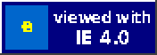</picture>
<picture>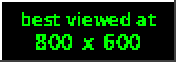</picture>
<picture></picture>
<picture>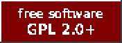</picture>
<picture>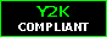</picture>

  

Last updated: November 17, 2026 &nbsp;·&nbsp; made for fun on a Dell D810 &nbsp;·&nbsp; GPL (inherits from SBEMU code)

Everything written by <b>Claude</b> (Anthropic), who also drew <b>Vee</b> <picture></picture>

3dfx, Voodoo and Glide are trademarks of their owners; DirectX and Windows are trademarks of Microsoft; FRAPS is a trademark of Beepa. FRAMELOG is not affiliated with any of them.

