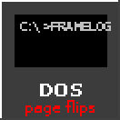

# FRAMELOG for DOS

FRAMELOG for DOS is a small program that stays in memory and watches the video card. Every time a game shows a new
frame, it writes down the exact time and sends it over the serial port. It draws nothing on the screen, doesn't
patch the game, and doesn't change any files. You load it once and then every game you start gets logged.

## Installing it

FRAMELOG runs inside HDPMI32i, the same DOS extender NUKED SB-EMU uses, so it goes after it in `AUTOEXEC.BAT`:

```
HDPMI32I.EXE -r -x
C:\FRAMELOG\FRAMELOG /COM:1
```

With NUKED SB-EMU, put it after the SC55 line. When it loads it tells you which COM port and baud rate it uses and
how fast it thinks your CPU is.

## Switches

You'll rarely need more than `/COM`, but here's the full list:

| Switch | What it does |
|---|---|
| `/COM:n[,baud]` | Which COM port (1-4) and speed. Default: COM1 at 115200. |
| `/COM:hex[,baud]` | A COM port at an unusual address, e.g. `/COM:2F8`. |
| `/AUTO` | Start logging straight away instead of waiting for the host. |
| `/3DA[:ms]` | For games that never flip pages (see below). Costs some CPU, so it's off by default. |
| `/NOVESA` | Leave VESA alone. Try this if a VESA game or UNIVBE acts up with FRAMELOG loaded. |
| `/NOMETA` | Don't send the run info (card, resolution, CPU...). |
| `/STATUS` | Show what the loaded copy has seen so far: flips, frames, lost frames, bytes sent and so on. |

## How it spots a frame

Most DOS games draw the next frame into a hidden page of video memory and then tell the card to show that page.
That "show this page now" moment is what FRAMELOG times. Games do it in a few ways, and FRAMELOG catches all of them:

- **Plain VGA and Mode X**: the game writes the new start address to the card (CRTC registers 0Ch/0Dh). This is
  the default and covers games like Duke Nukem 3D and Rise of the Triad. Several writes within half a millisecond
  count as one flip.
- **VESA**: SVGA games ask the VESA BIOS to switch pages, either through INT 10h function 4F07h or through the
  faster VBE 2.0 protected-mode interface. FRAMELOG hands the game a copy of the card's function table with one
  small change: SetDisplayStart notes the time first, then runs the card's own code. That's how Duke Nukem 3D's
  640x480 mode gets logged. This needs about 1.2 KB of DOS memory.
- **Games that never flip** (`/3DA`): some games draw straight onto the visible screen. If they wait for the
  vertical retrace before each frame, `/3DA` counts those waits instead. It's off by default because it slows the
  game's own wait loops down a bit; the frame rate itself stays the same.

A few games copy to the screen without waiting for anything (Heretic, Duke Nukem 3D in ScreenMode 2). There's
nothing to trap there, so for those the plan is a VGA capture card plus `flcap.py` (see [[Host Tools]]).

## Run info

When a log starts, FRAMELOG also tells the host what it's running on, so your CSV files label themselves:

- **gpu**: the name from the card's VESA BIOS, or just "VGA" if there isn't one
- **driver**: the VBE version and the card's software revision
- **res / depth / mode**: the screen mode, including the odd ones like Mode X at 320x240
- **cpu**: the CPU's name and the speed FRAMELOG measured

If the game switches screen modes mid-run, a new block goes out and the CSV gets a `# change@N=...` line at that
frame. Anything you type on the host side (`--gpu`, `--res`, a suite file) wins over what the game PC reports.

## Good to know

- It works with **protected-mode games** (DOS4GW, DJGPP, PMODE/W and friends). Real-mode games aren't logged yet;
  a `/RM` switch is in the works.
- Start and stop happen at the game's **next** frame, because that's when FRAMELOG looks at the serial port.
- Don't share the COM port with SBEMU's `/DBG` or with serial MIDI.

## Does it slow the game down?

Barely. On a Pentium II 450 page-flip logging costs about **0.35%** of the CPU at 70 fps. VESA flips and the run
info cost nothing I could measure. SB-EMU and the SC-55 emulation run exactly as before; FRAMELOG doesn't touch the
timer or the keyboard.

## The FLIP test program

`FLIP.EXE` is a tiny fake game for checking your setup:

```
FLIP seconds fps [long] [M] [B]
```

It flips the screen at a steady rate, and every *long*-th frame (default every 10th) takes twice as long, so you can
see that FRAMELOG catches the hiccups too. `M` plays some MIDI on the MPU-401 at the same time, and `B` uses VESA
flips at 640x480 instead.
