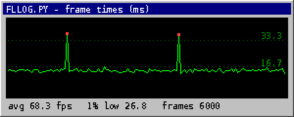

# Host Tools



The host is the second PC at the other end of the cable. It does everything the game PC shouldn't have to: saving
the frames, crunching the numbers and drawing the graphs. The tools are small Python scripts from
[serial-bench](https://github.com/deon81997/serial-bench), and a copy ships in the zip's `HOST` folder.

You need Python 3 and two libraries:

```
pip install pyserial matplotlib
```

<br clear="right">

## fllog.py: recording

This is the one you'll use every time. It tells the game PC to start, writes every frame to a CSV file, and tells it
to stop when you press Ctrl+C.

```
fllog.py COM3 -o run.csv --label D810
```

The port can be `COM3`, `/dev/ttyUSB0`, or even a network address like `socket://127.0.0.1:4555` if your "game PC"
is an emulator.

### Labelling your runs

Each CSV starts with a few `# key=value` lines describing the run. The game PC fills most of them in by itself (card,
resolution, CPU...), but you can add or override anything:

```
fllog.py COM3 -o duke.csv --gpu "Voodoo3 3000" --res 640x480 --game "Duke3D" --notes "fresh boot"
```

There's also `--driver`, `--depth`, `--cpu`, and `--meta file.ini` for keeping the same labels in a file. If you and
the game PC disagree, your value wins and the game PC's is kept alongside as `pc_res` and so on.

### Benchmark suites

Running ten timedemos one after another? Write them down in a small INI file and let `fllog.py` split the stream
into one CSV per game:

```ini
[suite]
name = d810-dos
gap = 5
min_frames = 30
gpu = ATI Mobility Radeon X300
cpu = Pentium M 2 GHz

[duke]
game = Duke3D 1.3D attract
res = 320x200
depth = 8

[rott]
game = ROTT 1.3 attract
res = 320x200
depth = 8
```

```
fllog.py COM3 --suite suite.ini -o results/ --report report/
```

A run ends when the game exits, or after `gap` seconds without frames. Tiny fragments (fewer than `min_frames`) are
thrown away, like a menu you flicked through. Files are named `game-gpu-res.csv`, and with `--report` you get the
HTML pages as soon as the suite finishes.

## flstats.py: the numbers

```
flstats.py run.csv --png run.png
```

For each run you get the frame count, the length, the average fps, the shortest and longest frames, and the **1% and
0.1% lows**. Those lows are the frame rate of the slowest 1% and 0.1% of frames, and they're the best single
numbers for "does it stutter?". The PNG shows every frame's time, so the hitches jump right out.

Give it several CSVs and they're compared on one graph. `--group-by gpu` pools runs per card, `--where game=Duke3D`
filters, and `--skip 5` ignores the first five seconds (loading screens).

## flreport.py: a web page per GPU

```
flreport.py results/ -o report/
```

Point it at a folder of CSVs and it builds a little website: one page per graphics card with numbers, a frame-time
graph and a percentile curve for every game, a `compare.html` with all the cards side by side, and an index page.
Graphs have hover tooltips, and the pages work offline in light or dark mode. If older CSVs lack a label, fill it
in with `--default gpu="S3 Trio64"`.

## flcap.py: when the game can't be trapped

Some DOS games draw straight onto the visible screen without ever flipping, and nothing on the game PC can see
those frames. For them there's `flcap.py`: record the VGA output with a capture card, and it works out the frame
times from the video itself. It finds tear lines, repeated frames and "runts" (frames that only showed for a
sliver of the screen).

```
flcap.py capture.avi -o run.csv --fps 70.086
```

The CSV it writes looks just like the others, so flstats and flreport work on it too. If you also logged the same
run over serial, `--serial run.csv` lines the two up. It needs `pip install opencv-python numpy`.

## Under the hood

`flproto.py` speaks the wire format, including the run-info records, and recovers if line noise garbles a byte
(see [[Serial Protocol]]). The tools have their own tests: `python3 -m unittest discover -s tests`. To play with the
reports without any hardware, `python3 tests/synth.py /tmp/syn` makes some fake runs.
