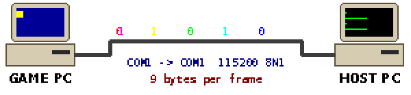

# Quick Start

This gets you from zero to your first frame-time graph. You need two PCs, one cable and about five minutes.



## What you need

- **The game PC**: your retro machine, running DOS or Windows 98, with a COM port.
- **The host PC**: anything that runs Python 3 (Windows or Linux), with a COM port or a cheap USB-serial adapter.
- **A null-modem cable.** This is the one gotcha. A normal "straight" serial cable won't work; the send and receive
  wires have to be crossed. If nothing arrives on the host, check the cable first.
- **The zip**: [FRAMELOG-0.1-test7.zip](https://github.com/deon81997/framelog/releases/tag/v0.1-test7). It has a
  `FRAMELOG` folder (DOS), a `WIN98` folder and a `HOST` folder.

<br clear="right">

## Step 1: set up the host

Install Python 3, then the two libraries the tools need:

```
pip install pyserial matplotlib
```

Copy the `HOST` folder over and start the logger. It's fine to start it before the game; it just waits.

```
py fllog.py COM3 -o run.csv --label D810
```

On Linux that's `python3 fllog.py /dev/ttyUSB0 -o run.csv --label D810`. On Windows there's also a shortcut,
`LOG.BAT COM3 run.csv D810`.

## Step 2a: a DOS game PC

Copy `FRAMELOG.EXE` to something like `C:\FRAMELOG`, and add this to `AUTOEXEC.BAT`:

```
C:\FRAMELOG\FRAMELOG /COM:1
```

It has to come **after** the `HDPMI32I.EXE -r -x` line (or after the SC55 line if you use NUKED SB-EMU), because
FRAMELOG lives inside HDPMI32i. Reboot and you should see it print its COM port, baud rate and CPU speed.

Want to try it before a real game? Run `FLIP 20 70`. It flips the screen 70 times a second for 20 seconds, so your
log should show a nice flat line at 70 fps.

## Step 2b: a Windows 98 game PC

Copy `FRAMELOG.EXE` and `FLHOOK.DLL` into one folder. Then you have two choices:

- Run `FRAMELOG /COM:1`, then start your games the usual way. Every game that draws something gets logged in
  turn.
- Or let FRAMELOG launch one game for you:

  ```
  FRAMELOG /COM:1 C:\QUAKE2\QUAKE2.EXE +timedemo 1 +demomap q2demo1.dm2
  ```

When you're done, quit FRAMELOG with **Q**, **Esc** or **Ctrl+C** (or `FRAMELOG /STOP` from a batch file).
Please always quit it before you shut down; it puts Windows' DirectDraw tables back the way it found them.

To check the setup, `WIN98\TEST\DDTEST 600 30` should give you 599 frames at 33.3 ms each.

## Step 3: look at the results

Press Ctrl+C on the host when the run is over, then:

```
py flstats.py run.csv --png run.png
```

You get average fps, the 1% and 0.1% lows (the numbers that tell you about stutter), and a frame-time graph. Give it
several CSVs and it compares them. For a whole folder of runs there's an HTML report too:

```
py flreport.py results/ -o report/
```

All of that is explained on **[[Host Tools]]**.
