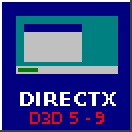

# FRAMELOG for Windows 98

The Windows 98 version is two files: `FRAMELOG.EXE`, which you run, and `FLHOOK.DLL`, which it slips into the games.
Every time a game puts a finished frame on screen, the DLL reads the CPU's clock and drops the time into a shared
buffer. FRAMELOG.EXE sends that buffer down the serial cable to the same host tools the DOS version uses.

That's all the game pays for: one clock read per frame. Nothing is installed and no files are replaced. FRAMELOG
doesn't use fake `ddraw.dll` or `opengl32.dll` copies. Everything is changed in memory and put back when it quits.
It works on Windows 95, 98 and ME, but not on NT, 2000 or XP.

## What counts as a frame

Each graphics API has its own way of saying "this frame is done". FRAMELOG listens for all of them:

| API | What FRAMELOG listens for |
|---|---|
| DirectDraw, Direct3D 5-7 | `Flip` in full screen; `Blt` or `BltFast` to the screen in a window, or in games like Quake II's software renderer |
| Direct3D 8 and 9 | `Present` |
| Glide 2 and 3 | `grBufferSwap` |
| OpenGL | `wglSwapBuffers` from any OpenGL DLL (the card's driver, a 3dfx MiniGL, or a copy in the game folder), and `SwapBuffers` |

A few rules keep the count honest:

- Only calls that **worked** count. If the card says "still busy, try again", that's not a frame.
- Some APIs call each other: a Direct3D 8 Present flips through DirectDraw underneath, and `SwapBuffers` ends up in
  `grBufferSwap` on a 3dfx card. FRAMELOG counts only the outermost call, so you never see double frames.
- If a game both flips and blits to the screen, only the flips count.
- When the host says "start", the next frame is the starting line, so N frames on screen give you N-1 frame times.

## Running it

There are two ways.

**Run FRAMELOG first, then play.** Type `FRAMELOG /COM:1` and start your games however you like. FRAMELOG logs the
first program that draws a frame until it exits, then waits for the next one. This is great for a batch of
timedemos run with `fllog.py --suite`.

**Let FRAMELOG start the game.**

```
FRAMELOG /COM:1 C:\GAMES\QUAKE2\QUAKE2.EXE +timedemo 1 +demomap q2demo1.dm2
```

This logs only that game and quits when it does. It also gets itself into the game the moment it starts, so it
catches games that never open a normal window too.

When you're done, press **Q**, **Esc** or **Ctrl+C** in FRAMELOG's window, or run `FRAMELOG /STOP` from a batch file.
Do this before you shut down, so DirectDraw is put back the way it was.

| Switch | What it does |
|---|---|
| `/COM:n` | COM port (default 1) |
| `/BAUD:n` | Speed (default 115200) |
| `/LOG` | Writes `FRAMELOG.LOG` next to the exe: what got hooked, which game is logged, and how many Flip / Blt / BltFast calls each program made. Handy when something isn't logging. |
| `/NOINJECT` | When launching a game, only use the window hooks, without patching the game's start |
| `/Q` | No status line |
| `/STOP` | Stop a running FRAMELOG |

The status line tells you what's going on: idle, armed (waiting for the next frame) or logging, plus the program,
the frame count and any lost frames.

## Run info

When a log starts, FRAMELOG sends the host a short description of the run: the game's exe name, the graphics card
and driver as the game's own API sees them, the resolution and colour depth, which API it uses, the CPU, and the
Windows version. Your CSVs come out labelled without you typing anything.

## How the hooks work

If you're curious:

- **DirectDraw**: on Windows 9x, DirectDraw keeps its function tables in memory every program shares. FRAMELOG
  points the Flip, Blt and BltFast entries at small stubs that check which program is calling. DirectDraw sometimes
  rebuilds those tables, so a watchdog puts the stubs back when it does.
- **Direct3D 8/9**: FRAMELOG follows `Direct3DCreate8/9` to the device, then hooks its `Present`.
- **Glide and OpenGL**: a small jump at the start of the swap function, including DLLs the game loads later.
- **Getting into the game**: Windows' own window hooks load FLHOOK.DLL into every program with a window. When
  FRAMELOG launches the game itself, it also starts it paused and loads the DLL before the game's first instruction.

## Good to know

- **Direct3D 8/9** games are only caught if FRAMELOG is running before the game creates its device, so start
  FRAMELOG first or let it launch the game. Direct3D 9 also needs a DirectX 7-class driver. The Voodoo3's 1.02.18
  driver can't do D3D9 at all (D3D8 is fine).
- **Glide 2** on 3dfx drivers counts the spinning 3dfx logo as frames. `SET FX_GLIDE_NO_SPLASH=1` before the game
  hides it.
- A program that never opens a window is only caught when FRAMELOG launches it.
- DOS games in a Windows DOS box: use the DOS version in a real DOS boot instead.
- One FRAMELOG at a time, logging one program at a time.
- If FRAMELOG gets killed with End Task while a DirectDraw game is running, quit that game before starting FRAMELOG
  again.
- 3DMark99 crashes in the 86Box emulator with or without FRAMELOG, so it still needs a real-hardware test.

## Test programs

The `WIN98\TEST` folder has small programs that draw at a fixed rate, so you can check that what FRAMELOG logs is
exactly what was drawn. Each takes a frame count and a frame rate, and writes a one-line result to `<name>.TXT`.
Add `spin` to make it count spare CPU time (that's how the cost numbers on [[Measurements]] were made).

| Program | Draws with |
|---|---|
| `DDTEST [blt\|fast] [modex] N FPS` | DirectDraw at 640x480: page flips, or a windowed Blt (`blt`), or a full-screen BltFast like Quake II (`fast`); `modex` allows Mode X |
| `DDDYN N FPS` | Same as DDTEST, but loading DirectDraw by hand like Quake II does |
| `D3DTEST [hal] N FPS` | Direct3D 6, software or the card's hardware (`hal`) |
| `GLTEST [wgl] N FPS` | OpenGL in a small window |
| `G2TEST [nowin] N FPS` | Glide 2, using your card's `glide2x.dll` |
| `D3D8TEST` / `D3D9TEST [win] [sc] N FPS` | Direct3D 8 / 9, full screen or windowed (`win`) |

If everything is right, the host sees N-1 frames, each 1000/FPS milliseconds long, with none lost.
