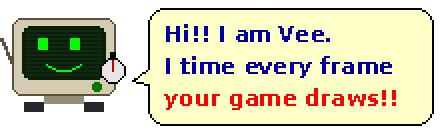

# Welcome to the FRAMELOG wiki

FRAMELOG answers one question about old PCs: **how smooth does this game actually run on this machine?**

Average fps alone doesn't tell you much. A Voodoo3 that averages 60 fps but stutters every second feels worse than a
card that holds a steady 45. To see that you need the time of every single frame, and on a 1999 PC that's harder
than it sounds. FRAPS draws over your picture and writes to the disk while you play, and plain DOS has no tool like
it at all.

So FRAMELOG does it differently. The **game PC** notes the exact moment each frame reaches the screen and sends it
down a **serial cable** to a **second PC**. The game PC does almost no extra work (well under 1% in every test so
far). The second PC does the heavy lifting: saving, stats, graphs, reports.

## What's in the box

There are three parts, all in one zip:

- **FRAMELOG for DOS** sits in memory and notices every page flip a DOS game makes: plain VGA, Mode X and VESA,
  plus every buffer swap in 3dfx Glide games.
  It runs happily next to [NUKED SB-EMU](https://github.com/deon81997/NUKED-SBEMU).
- **FRAMELOG for Windows 98** hooks the way a game puts a frame on screen: DirectDraw, Direct3D 5 to 9, Glide and
  OpenGL. Everything happens in memory, so no game or system files are touched.
- **The host tools** (from [serial-bench](https://github.com/deon81997/serial-bench)) run on any modern PC. They log
  the frames to CSV files, print the numbers, draw graphs, and build HTML pages that compare GPUs side by side.

## Where to go next

New here? Start with **[[Quick Start]]**. You can have your first log in a few minutes.

Then, depending on what you're doing:

- Logging DOS games: **[[DOS FRAMELOG]]**
- Logging Windows 98 games: **[[Windows 98 FRAMELOG]]**
- Turning logs into numbers and pretty pages: **[[Host Tools]]**
- Wondering if your game works: **[[Game Coverage]]**
- Wondering if you can trust the numbers: **[[Measurements]]**
- Testing on real hardware for me: **[[Hardware Test Checklist]]**
- Curious how the bytes look on the wire: **[[Serial Protocol]]**
- What's broken and what's next: **[[Known Issues and Roadmap]]**, **[[Changelog]]**

## Download

The current test build is **[v0.1-test6](https://github.com/deon81997/framelog/releases/tag/v0.1-test6)**. It's
still a test build: everything works in emulators, and real-hardware runs are next. If you try it, I'd love to see
your CSVs!

---

FRAMELOG's code, docs and art are written by Claude, an AI by Anthropic. I pick what to build and test it on my
real PCs.
